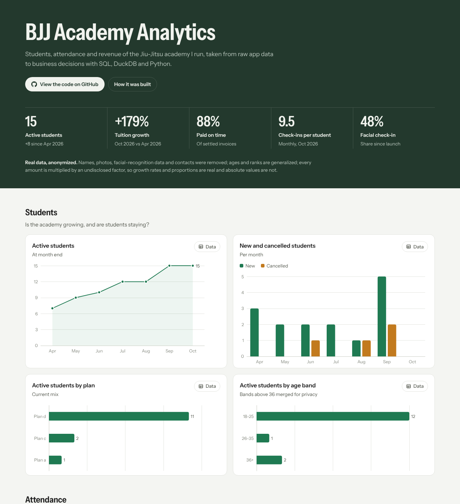

# BJJ Academy Analytics

**From raw data to business decisions:** an end-to-end BI project built on real, anonymized operating data from a small Brazilian Jiu-Jitsu academy that I run.

**[View the live dashboard →](https://YOUR-GITHUB-USERNAME.github.io/bjj-academy-analytics/)**



## Why this project

At work I run the full BI cycle (validating data against the source system, writing SQL, building ETL, modeling and presenting results), but that data is confidential. This project applies the same cycle to a business I own, so the whole process can be public.

The questions it answers:

- **Growth:** Is the student base growing, and how many students cancel each month?
- **Engagement:** How often do students train, and which days fill the mat?
- **Revenue:** How has tuition grown, how reliably is it paid, and how much comes from product sales?
- **Costs:** Where does operating money go?
- **Operations:** How quickly was facial-recognition check-in adopted after launch?

## Headline results (Apr–Oct 2026)

| KPI | Result |
|---|---|
| Active students | 7 → 15 |
| Tuition billed, growth | +179% (Oct vs Apr) |
| Payments made on time | 88% |
| Check-ins per attending student | 9.5 per month (Oct) |
| Facial check-in share since launch | 48% |

## Stack

| Layer | Tool |
|---|---|
| Source | The academy's management app (CSV export) |
| Warehouse | DuckDB (local, file-based) |
| Transformation & KPIs | SQL |
| Orchestration | Python (`scripts/build.py`) |
| Visualization | Static HTML page + ECharts, hosted on GitHub Pages |

No BI license is needed to open the dashboard: it is a single static page that loads instantly in any browser.

## Data model

A star schema with four dimensions and four fact tables, plus two derived tables built in SQL:

```
dim_students ─┐                    ┌─ fact_attendance
dim_classes  ─┤                    ├─ fact_payments
dim_plans    ─┼── (keys) ──────────┼─ fact_sales
dim_products ─┘                    └─ fact_financial_transactions

derived:  dim_month          (month calendar for the analysis window)
          fct_student_month  (one row per student per enrolled month → growth & churn)
```

Full column definitions are in [`data/data_dictionary.md`](data/data_dictionary.md).

## Pipeline

```
data/raw/*.csv
   │
   ├─ sql/01_staging.sql   type columns, clean blanks, flag owner equity flows
   ├─ sql/02_model.sql     month calendar, student-month snapshot, enriched attendance
   └─ sql/03_kpis.sql      one named query per dashboard block
   │
scripts/build.py           runs the SQL in DuckDB, exports JSON, renders the page
   │
site/index.html            the published dashboard
```

Run it locally:

```bash
pip install -r requirements.txt
python scripts/build.py
# open site/index.html in a browser
```

## Data quality decisions

- **Analysis window: April to October 2026.** April is the first month with tuition data; November was still open when the data was exported.
- **Attendance starts in May 2026.** Earlier months only hold one student's imported history, which would distort per-student averages.
- **Unknown class slot.** On Mondays and Wednesdays (two classes a day), imported check-ins carry no class ID. They count in daily totals but not in the morning/evening split.
- **Owner equity flows excluded.** Owner contributions and withdrawals are not operating income or expenses.
- **Churn rule.** A student is active from the enrollment month until the month before cancellation; the cancellation month counts as a churn event.

## Privacy and anonymization

This is real data, so privacy came first:

- **Removed:** names, documents, contacts, addresses, free-text notes, and all photos and facial-recognition data.
- **Pseudonymized:** every student, class, plan and product has a random surrogate key.
- **Generalized:** ages are shifted by a random offset and reduced to bands (merged above 36 to avoid a group of one); belt ranks are generic and shuffled between students.
- **Minors:** students under 18 appear only as an aggregated monthly count.
- **Money:** tuition is multiplied by one undisclosed factor (so growth rates and recurrence stay real); every other value gets its own random factor. **Absolute amounts are not the academy's real figures.**

## Repository structure

```
├── data/
│   ├── raw/                  anonymized CSV exports
│   └── data_dictionary.md
├── sql/                      staging, model and KPI queries
├── scripts/build.py          pipeline
├── dashboard/template.html   dashboard layout and charts
├── site/                     generated dashboard (published to GitHub Pages)
└── .github/workflows/        build and deploy on every push
```

## Author

**Lucas Arruda**, Data Analyst · End-to-end BI: SQL, ETL & Data Modeling
[LinkedIn](https://www.linkedin.com/in/YOUR-LINKEDIN-URL)
